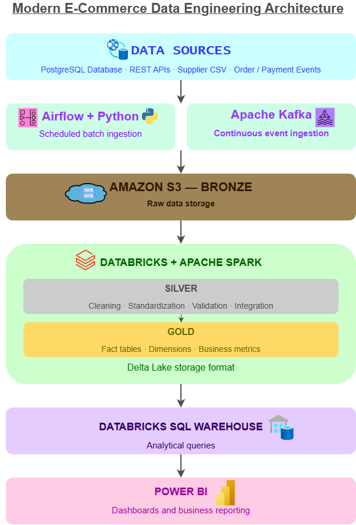

# Modern Data Engineering Platform for E-Commerce

## 1. Project Overview

This project presents the design and implementation of a modern data engineering platform for an e-commerce company processing approximately 1 million orders per day, with a planned scaling capability of up to 10 million orders per day.

The platform is designed to ingest data from multiple sources, process batch and streaming workloads, maintain data quality, and provide reliable analytics for business decision-making.

The proposed production architecture uses Apache Kafka, Apache Spark, Apache Airflow, Amazon S3, Databricks and Power BI.

A local working prototype has also been implemented using Python and PostgreSQL to demonstrate the core ingestion, transformation and analytical workflows.

## 2. Business Requirements

The platform addresses the following requirements:

- Ingest data from relational databases, REST APIs, CSV files and streaming events.
- Implement a Bronze–Silver–Gold Medallion Architecture.
- Support both batch processing and real-time event processing.
- Build a dimensional model using a Sales Star Schema.
- Provide analytical SQL queries using joins, CTEs and window functions.
- Maintain data quality and handle duplicates, missing values and pipeline failures.
- Support growth from 1 million to 10 million orders per day.
- Optimize infrastructure and processing costs.

## 3. Proposed Production Architecture

### Architecture Flow

1. **Data Sources:** PostgreSQL operational databases, REST APIs, supplier CSV files and order/payment events.

2. **Ingestion:** Apache Airflow orchestrates scheduled batch workflows. Apache Kafka handles continuous streaming events.

3. **Data Lake:** Amazon S3 stores raw data in the Bronze layer.

4. **Processing:** Databricks and Apache Spark process data through the Medallion Architecture using Delta Lake.

5. **Analytics:** Databricks SQL Warehouse queries the Gold layer.

6. **Visualization:** Power BI provides dashboards for sales, product performance and customer analysis.

### Medallion Architecture

- **Bronze:** Preserves raw data from the source systems.
- **Silver:** Standardizes, validates, deduplicates and integrates the data.
- **Gold:** Stores business-ready analytical data, including fact and dimension tables.

The prototype additionally uses a PostgreSQL staging schema as an intermediate landing area for file-based sources. Staging is an implementation component, not an additional Medallion layer.

## 4. Technology Selection

| Technology               | Purpose                                  | Reason for selection                                        |
| ------------------------ | ---------------------------------------- | ----------------------------------------------------------- |
| Apache Kafka             | Streaming ingestion                      | Distributed event streaming and scalable message handling   |
| Apache Spark             | Data processing                          | Distributed processing of large datasets                    |
| Apache Airflow           | Workflow orchestration                   | Scheduling, dependency management, monitoring and retries   |
| PostgreSQL               | Operational database and local prototype | Relational storage and SQL processing                       |
| Amazon S3                | Data lake storage                        | Scalable and durable object storage                         |
| Databricks               | Data processing platform                 | Integrates Spark, Delta Lake and data engineering workflows |
| Databricks SQL Warehouse | Analytical queries                       | SQL-based analytics on curated data                         |
| Power BI                 | Visualization                            | Business reporting and dashboards                           |

### Cloud Data Warehouse Comparison

- **Databricks SQL:** Selected for its integration with Spark and Delta Lake, supporting a unified lakehouse architecture.
- **Snowflake:** A managed cloud data warehouse with separate compute and storage scaling and strong SQL analytics capabilities.
- **Google BigQuery:** A serverless analytical warehouse with managed infrastructure and integration with Google Cloud.
- **Amazon Redshift:** An AWS-native analytical warehouse that integrates with services such as Amazon S3.

Databricks SQL is selected for this proposed architecture because it integrates naturally with the chosen Spark and Delta Lake processing environment.

## 5. Batch Processing vs Real-Time Streaming

**Batch processing:**

- Used for supplier CSV files, periodic API ingestion and scheduled reporting.
- Orchestrated using Apache Airflow.
- Suitable when immediate data availability is not required.

**Real-time streaming:**

- Used for order placement, payment updates and other business events.
- Kafka transports events, and Spark Structured Streaming processes them.
- Suitable for applications requiring low-latency data processing.

The processing method is selected according to business requirements rather than using streaming for every source.

## 6. Sales Star Schema

The Gold layer implements a Sales Star Schema.

**Fact table:** `fact_sales`

**Dimension tables:**

- `dim_date`
- `dim_customer`
- `dim_product`
- `dim_payment_method`

**Fact table grain:** One row represents one order item (product line) within an order.

Measures include:

- Quantity
- Gross sales
- Discount amount
- Net sales

Gross Sales = Quantity × Unit Price

Net Sales = Gross Sales − Discount Amount

Only completed orders are included in the sales fact table so cancelled orders do not contribute to completed sales revenue.

## 7. Analytical SQL Queries

Three analytical queries have been implemented:

1. **Monthly Sales by Product Category:** Analyses monthly revenue, discounts, order counts and units sold for each product category.

2. **Top Three Products by Monthly Sales:** Uses `ROW_NUMBER()` to rank products by net sales within each month.

3. **Customer Sales Ranking and Cumulative Revenue:** Uses `DENSE_RANK()` and windowed `SUM()` to analyse customer revenue ranking, cumulative sales and revenue contribution.

The queries use joins, Common Table Expressions (CTEs), aggregation and window functions.

## 8. Data Quality and Reliability

The implementation includes the following checks and controls:

- Duplicate primary-key checks.
- Missing mandatory field checks.
- Numeric value validation.
- Referential integrity checks using foreign keys.
- Event deduplication using `ROW_NUMBER()`.
- Revenue reconciliation between Silver and Gold.
- Preservation of missing optional values, such as customer email.

The sample customer data contains one missing email, which is preserved as NULL rather than replaced with fabricated information.

In the Python prototype, database transactions provide rollback on loading failures, and errors are surfaced for investigation.

In the proposed production architecture, Airflow retries, Kafka event retention, Spark checkpointing and rejected-record quarantine can provide additional recovery and fault-tolerance mechanisms.

## 9. Scaling from 1 Million to 10 Million Orders per Day

The production platform can scale through:

- Increasing Kafka partitions and consumer capacity.
- Distributed Spark processing and workload autoscaling.
- Incremental data processing.
- Appropriate data partitioning, particularly by date.
- Delta Lake file optimization and compaction.
- Scaling the analytical warehouse according to query workload.
- Monitoring processing throughput, latency and backlog.

The average arrival rate increases from approximately 11.6 orders per second at 1 million orders per day to 115.7 orders per second at 10 million orders per day. Production capacity must also account for peak traffic and multiple events per order.

## 10. Cost Optimization

- Use autoscaling and right-sized compute resources.
- Schedule batch workloads instead of keeping resources running continuously.
- Use incremental processing rather than repeatedly processing historical data.
- Compress and optimize data files.
- Apply data retention and lifecycle policies to older raw data.
- Optimize analytical queries and avoid unnecessary scans.
- Monitor storage, compute and query costs.

## 11. Local Prototype Implementation

The working prototype demonstrates the main pipeline locally.

| Production component      | Local prototype implementation                         |
| ------------------------- | ------------------------------------------------------ |
| Amazon S3                 | Local Bronze folders                                   |
| Apache Kafka              | JSONL event files processed in simulated micro-batches |
| Apache Spark / Databricks | PostgreSQL SQL transformations                         |
| Apache Airflow            | Python scripts executed manually in sequence           |
| Databricks SQL Warehouse  | PostgreSQL analytical queries                          |
| Power BI                  | Not implemented locally; PostgreSQL analytical query outputs demonstrate the analytics                      |

The prototype does not claim to deploy or benchmark a production Kafka, Spark, Airflow or AWS environment. These technologies form part of the proposed production design.

The external API products are kept in a separate Silver table because their IDs do not match the internal product catalogue. No unsupported product mapping is assumed.

## 12. Repository Structure

- `sql/` — Source setup, staging, Silver, Gold, analytical queries and data-quality SQL.
- `src/` — Python ingestion and staging-loading scripts.
- `data/source_files/` — Sample supplier inventory and streaming event inputs.
- `data/bronze/` — Raw ingested source files.
- `docs/` — Architecture diagram.
- `presentation/` — Presentation.

## 13. Running the Local Prototype

### Prerequisites

- Python 3
- PostgreSQL
- Python package: `psycopg2-binary`
- Internet connectivity for the external API ingestion step

### Execution Sequence

1. Create the source database tables and sample data by running `sql/01_setup_source.sql`.
2. Run the four Python ingestion scripts:
   - `python src/ingest_postgres.py`
   - `python src/ingest_csv.py`
   - `python src/ingest_api.py`
   - `python src/ingest_stream.py`
3. Run `sql/02_create_staging_tables.sql`.
4. Load the Bronze files into staging:
   - `python src/load_staging.py`
5. Run `sql/03_silver_layer.sql`.
6. Run `sql/04_gold_layer.sql`.
7. Run `sql/05_analytical_queries.sql`.
8. Run `sql/06_data_quality_checks.sql`.

Database connection settings should be configured for the local PostgreSQL instance. The prototype uses database `ecommerce_demo` and port `5433`; adjust these settings if your local environment differs. The password is entered at runtime and is not stored in the source code.

## 14. Conclusion

This project demonstrates the design of a scalable e-commerce data engineering platform and a working local prototype of its core ingestion, transformation and analytics workflow.

The proposed production architecture supports both batch and streaming workloads, follows the Bronze–Silver–Gold Medallion Architecture, and provides a dimensional data model for business analytics.

The local implementation demonstrates the core concepts using Python and PostgreSQL, while the production design provides a path towards a distributed and cloud-based platform capable of supporting increasing data volumes.
